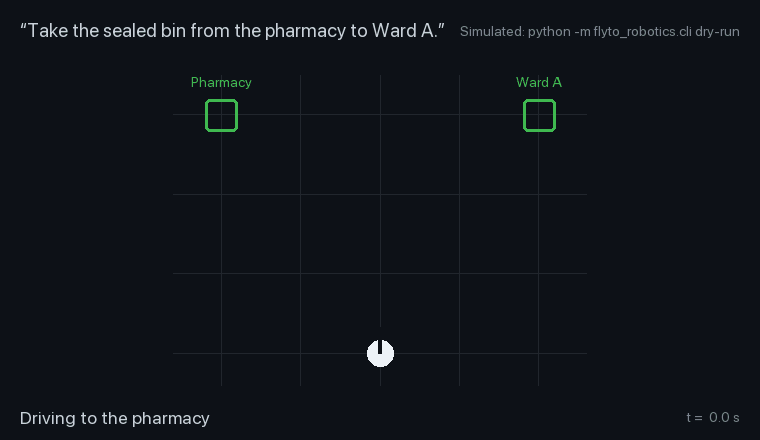

<div align="center">


# Flyto2 Robotics

**いま持っている ROS 2 ロボットに、Physical AI を。やることを伝えるだけ。ロボットには何もインストールしない。**

   

[English](README.md) · **日本語** · [한국어](README.ko.md) · [简体中文](README.zh-CN.md) · [Español](README.es.md) · [Português (BR)](README.pt-BR.md)

[クイックスタート](#クイックスタート) · [特長](#特長) · [しくみ](#しくみ) · [開発者向け](#開発者向け)



</div>

## クイックスタート

```bash
git clone https://github.com/flytohub/flyto-robotics && cd flyto-robotics
pip install -e .
python -m flyto_robotics.cli dry-run examples/jobs/pharmacy-to-ward.json   # a full delivery, simulated: no robot needed
```

あとはロボットを指定して（`export FLYTO_ROS2_SSH_HOST=ubuntu@my-robot.local`）、Flyto2 の Space に追加し、こう言うだけ：

> キッチンに行って写真を撮って。

## 特長

- **ロボットへのインストールはゼロ。** 純正の TurtleBot3 は純正のまま。Flyto2 のコードも認証情報も載せない。
- **ネイティブの ROS 2 で話す。** ロボットにすでにある Nav2、オドメトリ、LiDAR、カメラを動かす。
- **ぶつかる前に止まる。** 0.35 m の安全距離の内側にあるものへは進まない。
- **自分で回り道を見つける。** 道がふさがれても、同じ目的地への回り道を組み立てる。
- **場所を名前で覚える。** 「充電台に行って」。名前つきの場所はロボットの地図のそばに保存される。
- **到着は証拠つき。** Flyto2 が地図上の位置を自分で確かめる。ロボットの「着きました」だけでは認めない。
- **1台から、フリートまで。** Open-RMF のフリートもまったく同じ契約で動く。
- **ロボットなしで試せる。** 障害物での停止も含めた配送のシミュレーションが、ノート PC で数秒で動く。

## しくみ

1. やってほしいことを言う。
2. Flyto2 が段取りを組み、権限を確認する。
3. このアダプターが標準の ROS 2 でロボットの Nav2 を動かす。
4. Flyto2 が地図上の位置を確かめてから、完了とする。

---

## 開発者向け

アーキテクチャ、安全の仕組み、シミュレーション、テストの詳細は英語版にあります。 [README.md → For developers](README.md#for-developers)

License: Apache-2.0 (`LICENSE`, `NOTICE`).
